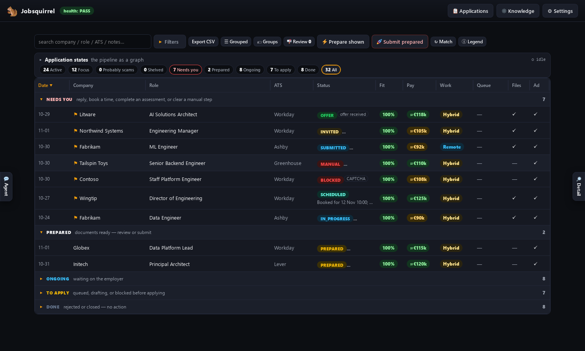
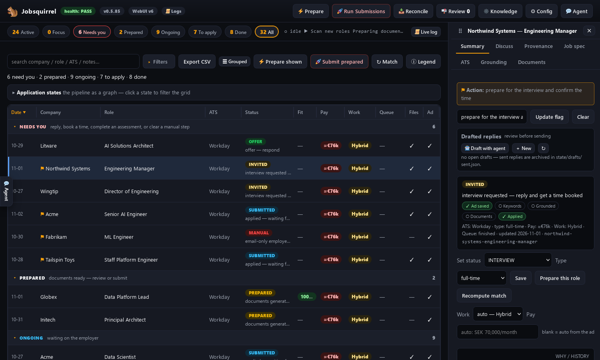
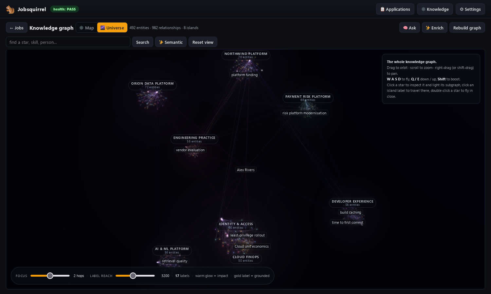
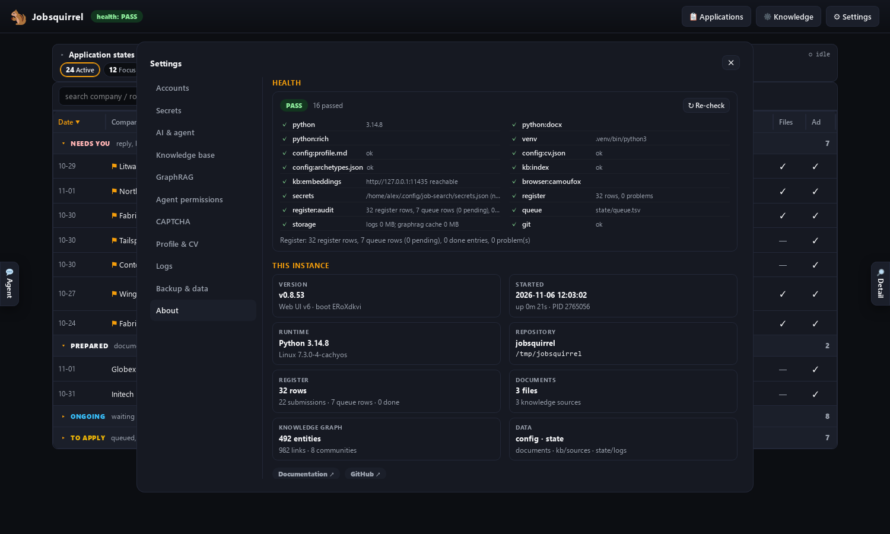

<div align="center">


# Jobsquirrel

**The register that keeps your job search straight, and the agent that builds the applications for you. Every role you are applying to, every application you have sent, every reply, in one place.**

Applying for a job should not be hard. Rewriting a CV for the fortieth time,
retyping the same details into another form, losing track of which version went
where, hunting through an inbox for a reply you may have missed. None of that is
the job you actually want. Jobsquirrel takes the pain out of it.

Give it your CV and your rules. It finds roles, writes a truthful CV for each one
(with a cover letter only when the advert asks), checks every claim before
anything is sent, applies through the employer's own site, and keeps a register
of exactly what went out, when, and on what evidence. Replies, interviews and
outcomes land in the same register. One place to see where you stand, and no
application you cannot account for.

[](https://github.com/bongomanuk/jobsquirrel/releases)
[](LICENSE)
[](https://github.com/bongomanuk/jobsquirrel/actions/workflows/ci.yml)
[](docs/SETUP.md)
[](https://bongomanuk.github.io/jobsquirrel/)

*Local-first. Truthful by construction. Yours to audit.*

[Quick start](#quick-start) · [Screenshots](#screenshots) · [Documentation](https://bongomanuk.github.io/jobsquirrel/) · [Scam detector](docs/SCAMS.md)

</div>

## What it does

- **Find** roles from job alerts, recruiter mail and the open web.
- **Tailor** a CV for each role, with a cover letter only when the advert asks, grounded in your own evidence.
- **Gate** every document for accuracy, ATS fit and AI slop before anything is sent.
- **Apply** through the employer's own ATS with a real browser, not a form-spam script.
- **Track** every role and every application in one register: what you applied to, what you sent, what came back, and what is still waiting.
- **Warn** on recruitment scams before you engage.

It runs on your machine: your CV, your inbox and your job search stay yours, and
nothing is sent without your approval. The project says CV; if you are in the US,
read it as resume.

## Screenshots

The screenshots use synthetic demo data: a sample candidate and fictional
companies.

| The grid: every role, its stage and its fit | Role detail: status, gates and next action |
|---|---|
|  |  |

| The knowledge universe: a central career hub and theme islands | Settings and health: version, checks and this instance |
|---|---|
|  |  |

More views and a full walkthrough are in the
**[documentation](https://bongomanuk.github.io/jobsquirrel/)**.

## Quick start

Start your agent and paste this:

```text
Clone https://github.com/bongomanuk/jobsquirrel.git into ./jobsquirrel and set it up with me: read AGENTS.md, then read docs/INTRO.md to me and run the first-run bootstrap in BOOTSTRAP.md.
```

The agent installs the dependencies, interviews you about your identity,
eligibility and the claims you must never overstate, builds your CV archetypes
and a private knowledge graph, and sets up your accounts.

Already cloned? Run `opencode` and say:

> Read AGENTS.md, introduce the project, and run the bootstrap.

Works with opencode, Claude Code, Cursor or any file-and-shell agent. Use a
hosted model or a local one. See [Agent setup](docs/AGENT-SETUP.md).

> **Not push-button autonomy.** The agent does the mechanical work. You own the
> rules, the approvals and the judgement calls. Review the first applications.

## Built to be trusted

- **No invented claims.** Every generated line is grounded in your CV, your
  profile or the knowledge graph.
- **Hard gates.** Alignment, evidence, ATS coverage, identity and AI-slop checks
  must pass before upload.
- **Human approval.** Email and calendar writes need your explicit approval.
- **Local-first.** The dashboard, register, documents, browser and graph run on
  your machine.
- **Scam-aware.** Remote-access interviews, wallet drains, pay-to-work and
  equipment cheques are flagged before you engage.
- **Open source.** Apache 2.0. Inspect it, adapt it, run it.

You are responsible for what it sends. Keep your config accurate, review the
gates, and read [DISCLAIMER.md](DISCLAIMER.md).

## Credits

The dynamic parts of the dashboard (Activity roster, grid rows and toolbar, role drawer,
knowledge search, context menu, role URLs and page title) use
**[Cascade](https://github.com/erobwen/liquefy)** by **Robert Renbris**, vendored under the
ISC license. See [how Cascade is integrated](docs/CASCADE.md),
[CREDITS.md](docs/CREDITS.md) and `tools/web/vendor/cascade.NOTICE`.

## Documentation

- [Introduction](docs/INTRO.md)
- [Setup](docs/SETUP.md)
- [Agent setup](docs/AGENT-SETUP.md)
- [Using it](docs/USING-IT.md)
- [Run modes](docs/RUN-MODES.md)
- [Knowledge graph](docs/KNOWLEDGE-GRAPH.md)
- [Scam detector](docs/SCAMS.md)
- [All documentation](https://bongomanuk.github.io/jobsquirrel/)

---

<div align="center" markdown>

**If it helps, give it a star.** It helps other people find it.

Built by [Peter Hollas](https://hollas.net) · [hollas.net](https://hollas.net)

Apache License 2.0 · [LICENSE](LICENSE)

</div>
