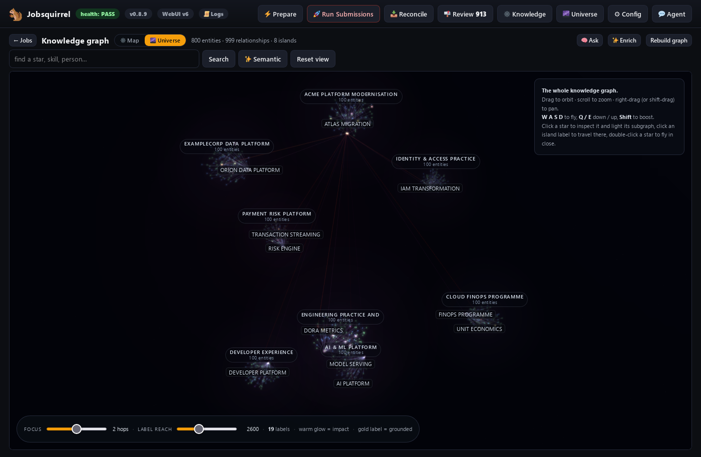
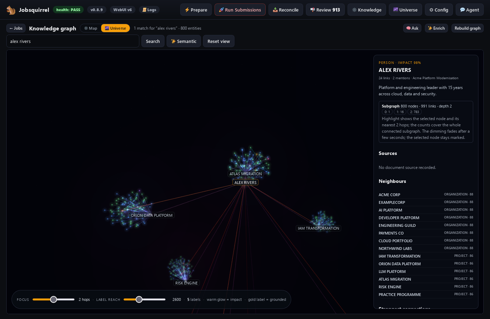
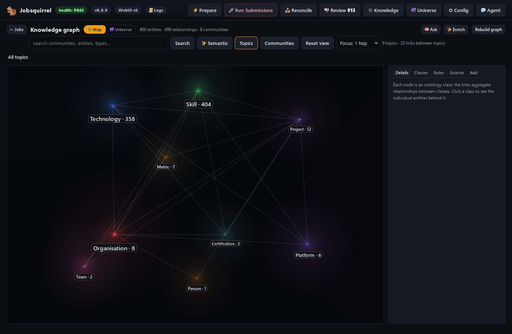
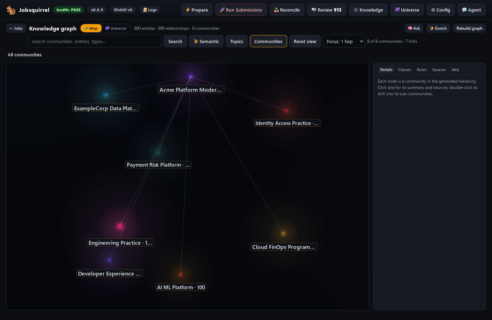

# The knowledge graph workspace

The **Knowledge** page is the visual layer over the GraphRAG index. It is not a
picture of the index: it is a working surface for inspecting evidence, finding
gaps, asking questions, and making grounded additions without editing the
generated index by hand.

The screenshots below use a small **synthetic demo graph** (fictional people,
companies and projects), so the documentation can be public without exposing a
real job search. Your own graph looks denser because it has your own evidence.

| The Universe — themes as islands, weighted stars and a focus ring | Focus — the selected entity, its neighbourhood and the details pane |
|---|---|
|  |  |

| Map — the same renderer, drilled down to ontology topics | Map — the generated community hierarchy |
|---|---|
|  |  |

## 1. What the graph is made of

The graph is built from `kb/sources/` by Microsoft GraphRAG into
`kb/graphrag/output/`:

| Table | What it holds |
|---|---|
| `entities.parquet` | Every person, organisation, role, skill, technology, project, metric, team, certification and concept, with a description, degree and source text units. |
| `relationships.parquet` | The evidence-backed links between entities, with a description, weight and source text units. |
| `communities.parquet` | The generated hierarchy (level 0 themes, then sub-communities) and the entities in each. |
| `community_reports.parquet` | The generated summary, findings and rating for each community. |
| `documents.parquet` / `text_units.parquet` | The source documents and the passages every claim is traced to. |

Two operator overlays sit beside the index and are merged at read time:

- `kb/graphrag/enrichment.json` — approved entities and links. New links are
  drawn in gold and marked as grounded.
- `kb/graphrag/edits.json` — description and type overrides for existing nodes.

`kb/graphrag/orphan-links.json` holds the curated links used to attach entities
that GraphRAG extracted without a relationship. See §9.

The overlay survives a rebuild. The generated tables do not; a rebuild replaces
them, and the overlays are applied again on top.

## 2. Two renderers, five ways to look

**Universe** is the whole graph. Every level-0 community is an island; the
best-connected entity gives the island its name. It is for orientation: where
the themes are, which entities carry them, and how the evidence crosses from one
theme to another.

**Map** is the drill-down renderer. It starts at the ontology or the community
hierarchy, then opens into the entities behind a class or community. It uses the
same point-star renderer, colours, importance, focus and fade as the Universe,
but on a subset.

| View | What it shows | How to open it |
|---|---|---|
| **Topics** | Ontology classes (Person, Organisation, Role, Skill, Technology, Project, Metric, Certification, Team, Platform, Product, Concept) with counts and the aggregated links between classes. | Knowledge → Map → **Topics**, or the **Topics** chip on the Universe. |
| **Communities** | The generated community hierarchy; double-click a community to descend until you reach entities. | Knowledge → Map → **Communities**. |
| **Entities** | The entities behind a topic or a leaf community. | Click a topic or open a community. |
| **Ego** | One entity plus its direct neighbours. | Double-click an entity, or **Focus ego network** in the node pane. |
| **Universe** | Every entity, grouped into level-0 theme islands. | The **Universe** button. |

Search works in every view. **Semantic** runs a natural-language search over the
entity vector store; results show similarity, impact and type, and selecting one
opens the same node pane.

## 3. Moving around

| Action | Result |
|---|---|
| Drag | Orbit the camera. |
| Wheel / trackpad | Zoom toward the point under the cursor. |
| Right-drag or Shift-drag | Pan. |
| `W A S D` | Fly through the scene; `Q` / `E` move down / up. |
| `Shift` | Boost the fly speed. |
| Click a star | Select the entity and open its details. |
| Double-click a star | Open its ego network in the Map. |
| Click an island label | Travel to that theme. |
| `Esc` | Leave the Universe and return to the Map. |
| Click empty space | Clear the focus and return to the previous view. |
| **Reset view** | Return to the overview camera. |

Text selection is disabled across the graph and its labels, so dragging never
leaves a blue highlight behind. Form fields in the side pane remain selectable.

## 4. Focus, the timed fade and labels

Selecting an entity does three things:

1. **It frames the neighbourhood.** The camera centres the entity and pulls back
   far enough to include its direct neighbours. An entity attached from the
   overlay (a skill linked to a person, for example) frames its anchor instead.
2. **It lights the subgraph.** The selected node and its neighbours keep their
   colour, gain a stronger halo and grow; everything outside the focus drops to
   near black. Level of detail no longer hides a neighbour that lives in another
   island.
3. **It labels the neighbourhood.** The selected node and its direct neighbours
   are labelled even when the zoomed label range would normally drop them.

The dimming is **temporary**. It holds for about four seconds and then fades back
over roughly one second. The selected node keeps its marker, size and label, so
you never lose what you selected. Clicking empty space clears the selection,
restores the view that was active before it, and re-runs the normal label
assignment immediately.

The **Focus** control sets how many hops stay bright:

- Universe: a slider (1–3 hops, default 2) in the bottom HUD.
- Map: a selector in the toolbar (1–3 hops, default 1).

Outside a focus, labels are tiered by zoom: the overview shows the key node of
each large island and the top hubs; zooming in reveals well-connected entities,
then named entities, then local detail. **Label reach** (Universe HUD) bounds how
far from the camera labels are drawn; it tightens automatically as you zoom in.

## 5. Weighted importance

Not every entity is equally important. `tools/graph_importance.py` runs a small
weighted message-passing pass over the relationship graph and scores each entity
from its connections, relationship weights, type and impact language in the
description. The degree of an entity matters, but a well-evidenced project or a
landmark outcome can outrank a merely well-connected name.

Those scores drive:

- node size and label priority;
- the order of topics and highlights in retrieval;
- the **impact** percentage in the node pane;
- which entities surface first in search and role evidence.

The cache is `state/graph-importance.json`; it is regenerated when the index
changes. High-impact nodes are the warm glow you see above the long tail.

## 6. The node pane

Clicking a star opens the details pane. It is the source of truth for what the
node is and why it is in the graph:

- title, ontology class, degree, mentions and community;
- description and, when available, an evidence note;
- **Subgraph** — node/link counts, maximum depth and a layer-by-layer breakdown;
- **Sources** — the documents behind the entity, clickable in the Sources tab;
- **Neighbours** — every directly connected entity, sorted by degree;
- **Strongest connections** — the highest-weight local relationships;
- **Edit details** — override the description or ontology type; the change goes
  to `edits.json`, not the generated index;
- **Add connection** — create a grounded link to another entity with the evidence
  that supports it; the link goes to `enrichment.json`;
- **Focus ego network** — open the entity and its neighbours in the Map;
- **Open community** — travel to the community that contains it.

Overridden types and descriptions are visible everywhere the node appears,
including search and context packs.

## 7. Ask the graph

**Ask** turns a natural-language question into a cited answer from the index. It
is not a chat model guessing from the CV; it is the graph retrieval engine:

- **Local** — follows the entities and relationships nearest the question.
- **Global** — uses community reports for a theme-level answer.
- **Basic** — a direct vector retrieval pass.
- **Drift** — a deeper local pass that follows several neighbourhoods.

Every answer carries citations to the source documents and entities. Use it to
answer questions such as "where is the evidence for the fraud platform?" or
"which roles show identity and access management?" before writing a CV line. If
the graph cannot support an answer, the answer says so instead of inventing one.

## 8. Role evidence, semantic search and enrichment

**Role evidence** maps the saved job ad's keywords to entities in the graph and
shows two lists: what the evidence supports and what it cannot confirm. That
distinction is what keeps generated CVs honest. A missing keyword is a gap to
leave out or address in the letter, not a claim to invent.

**Semantic search** searches the entity descriptions by meaning, not by exact
word. It is useful when the ad uses different language from your documents
("identity federation" versus "SSO/SAML").

**Grounded enrichment** proposes additions that are supported by existing text:
a technology mentioned but not linked, a certification that is in the sources,
a high-impact relationship, or an unrepresented metric. Every proposal is shown
for review with its evidence. Approved nodes and links are marked as grounded
and rendered in gold. Nothing is added silently.

## 9. No orphans: attaching unlinked evidence

An entity with no relationships cannot support a claim and has no place in a
theme. The graph therefore aims for **zero orphans**. There are three layers:

1. **GraphRAG extraction** normally produces relationships for every entity.
2. **The operator overlay** can attach a missed entity to the entities it
   obviously belongs with. The curated mapping lives in
   `kb/graphrag/orphan-links.json`; each entry names a target, a short
   description and the evidence it rests on.
3. **`tools/graph_attach_orphans.py`** applies the mapping:

   ```bash
   python3 tools/graph_attach_orphans.py --report
   python3 tools/graph_attach_orphans.py --apply
   ```

   It writes links to `enrichment.json`, places the attached entity in the
   level-0 community of its first mapped target, and refuses to write while any
   orphan is still unmapped. The link is a **display and retrieval aid**, not a
   new biographical claim: the description and evidence must come from the
   entity's own source text.

If an entity is genuinely unlinked and no honest link exists, the Universe keeps
it in a grey **Unlinked evidence** island rather than scattering it as a stray
star. The node pane explains that no relationship was extracted. The quality gate
reports it until it is either linked with evidence or removed.

## 10. Context packs and hybrid retrieval

The same graph produces the cited pack that grounds each CV and letter. The pack
is not a dump of the whole index:

- it starts from the job description and selects the relevant entities and
  relationships;
- **leadership-oriented roles** add global career themes and a coarser community
  level, while technical roles stay precise;
- weighted highlights, operator edits and approved links are appended so a
  landmark fact is not lost in a local search;
- only facts with a source are included;
- contract and legal material is redacted before the pack is written.

`tools/kb_graphrag.py` is the single retrieval path. The pack is saved as
`state/kb-context/<key>.md` and is the only evidence the document writer may use.

## 11. Privacy: contract and legal material never enters

The graph is for work evidence, not the legal machinery of an employment
contract. This is enforced at several points:

- `kb/sources/.ingestignore` excludes `contracts/*`, `reference-cv/*Contract*`
  and `reference-cv/*Juridiska*` before indexing.
- `tools/sensitive.py` holds the blocked title terms and the redaction terms
  (notice, probation, garden leave, salary, court, tribunal, jurisdiction,
  severance, settlement and similar).
- `tools/graph_prune_sensitive.py` removes blocked entities, entities left with
  no surviving text unit, their relationships, ungrounded communities and their
  reports; it recomputes degrees, drops dangling edges, redacts surviving
  descriptions/reports and cleans orphan vector rows.
- Context packs and Ask answers are redacted as a backstop.
- The quality gate fails if any blocked title, sensitive description, sensitive
  report or ungrounded entity remains.

The rule is simple: **if a fact exists only in a contract or legal document, it is
not in the graph.**

## 12. Quality gate

Run this after a rebuild or a prune:

```bash
.venv-graphrag/bin/python tools/graph_quality.py --fail-sensitive --fail-orphans
```

It reports:

- entity, relationship, text-unit and community counts;
- the degree distribution, including the long tail;
- exact and near-duplicate titles;
- teams in the wrong ontology class;
- community levels and the largest communities;
- relationship self-loops and duplicate pairs;
- sensitive titles, descriptions and reports;
- entities with no surviving text unit;
- entities with no link after overlays (orphans).

The command exits non-zero on sensitive/ungrounded material (`--fail-sensitive`)
or on any orphan (`--fail-orphans`). A healthy graph prints zero on all three:
no sensitive titles, no ungrounded entities, no orphans.

## 13. Maintaining the graph

```bash
bash tools/setup_kb.sh                        # ingest, embed, index
.venv-graphrag/bin/python tools/graph_prune_sensitive.py --apply
python3 tools/graph_attach_orphans.py --apply
.venv-graphrag/bin/python tools/graph_quality.py --fail-sensitive --fail-orphans
```

- **Incremental indexing is not reliable** with the current GraphRAG pipeline.
  The reliable path is a full rebuild, then prune, then attach.
- **Overlays survive rebuilds**; the generated parquet tables do not. Re-run the
  prune and the orphan attachment after every rebuild.
- **Adding a document** requires a rebuild. **Adding a skill or fact** from the
  dashboard does not: it is appended to every context pack immediately and shown
  through the live skill overlay, so you can re-prepare a role without waiting
  for an index.
- **Stale indexes are dangerous**: they surface stale claims. If a source was
  wrong, fix the source and rebuild; do not edit the generated pack by hand.

## 14. Limits worth knowing

- The Universe is a summary. A community with hundreds of entities is drawn as a
  dense island; the Map and the node pane are for detail.
- Community reports are generated at index time. After a prune, an affected
  report may be removed until the next rebuild; the entities and links are still
  current.
- Overlay links are keyed by entity title. Renaming an entity in a rebuilt index
  can orphan an overlay link; the quality gate will show the orphan.
- A very small graph looks sparse in the Universe: the layout is designed for
  hundreds to thousands of entities. Use the Map for small graphs.
- The 3D scene needs WebGL. Without it, the page shows a readable fallback and
  the rest of the dashboard still works.
