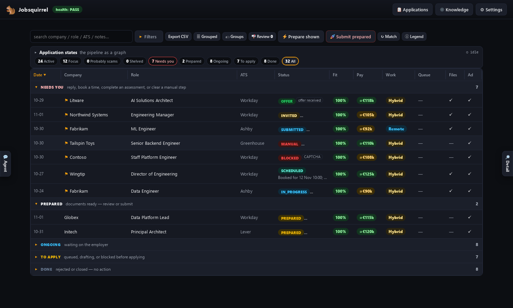
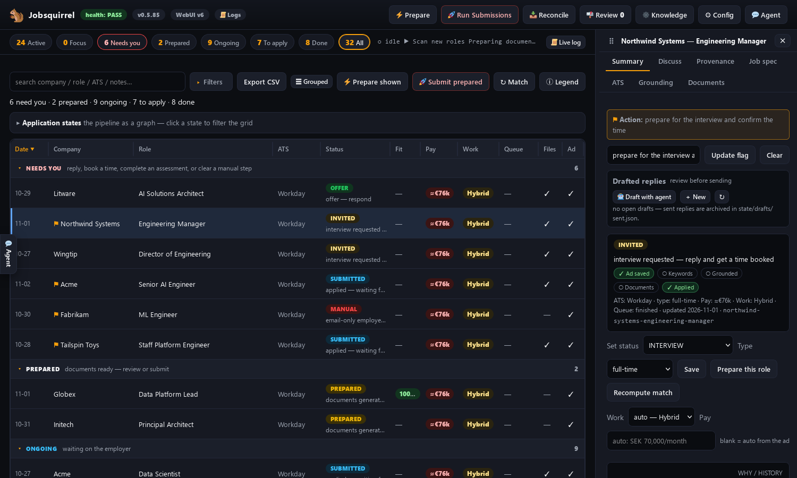
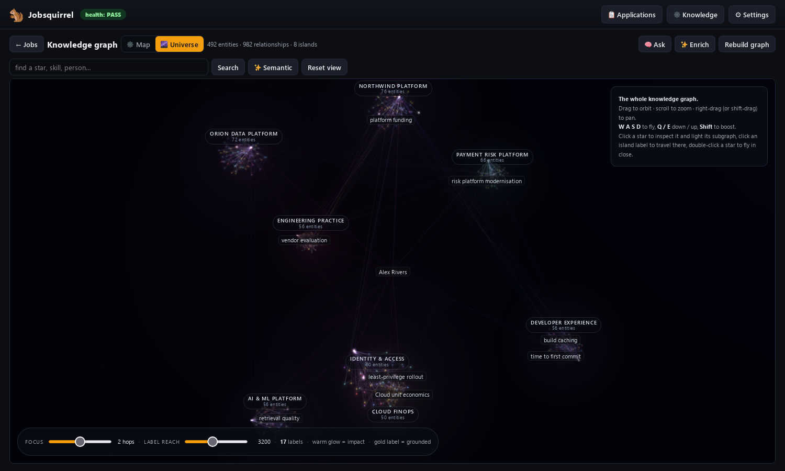

  

    <h1>🐿️ Jobsquirrel</h1>
    
<strong>An open, self-hosted job-application agent: hand it your CV (resume) and it finds, tailors, gates and applies to jobs for you.</strong>

    
Honest, targeted and auditable — with a real knowledge graph, hard gates before anything is sent, and a scam detector that knows the difference between a recruiter and a wallet drain.

    

      
      
      
      
      
      
    

    

      <a class="primary" href="SETUP/">Quick start →</a>
      <a href="USING-IT/">How to use it</a>
      <a href="SCAMS/">The scam detector</a>
      <a href="https://github.com/bongomanuk/jobsquirrel">GitHub ↗</a>
    

  

  

## What it does

  

🔎
<h3>Discover</h3>
Reads LinkedIn job alerts and recruiter mail, dedupes against the register, and queues the roles worth doing.

  

🎯
<h3>Target</h3>
A per-role CV and letter, grounded in your private knowledge graph, mirroring the advert without inventing anything.

  

🛡️
<h3>Gate</h3>
Alignment, evidence, ATS coverage, identity and no-AI-slop gates. Nothing is uploaded until they pass.

  

🤖
<h3>Apply</h3>
Drives the employer's own ATS through a real Camoufox browser, then records the exact files and hashes.

  

📬
<h3>Track</h3>
Reconciles Gmail, surfaces interviews and verification links, and keeps one source of truth for every role.

  

🕵️
<h3>Warn</h3>
Flags recruitment scams — remote-access interviews, wallet drains, task scams, money mules, reshipping — before you engage.

!!! tip "Everything is local"
    The dashboard, register, documents, browser and knowledge graph run on your
    machine. The only outbound calls are the ones you choose: the employer's site,
    Gmail/Calendar if enabled, and the model provider — **which can be a local
    model too**. Use opencode, Claude Code, Cursor or your own local AI agent.
    [Run it fully local →](AGENT-SETUP/#run-it-fully-local)

## A look at it

  
The grid — every role, its stage and its fit.

  
The role drawer — stage, gates, evidence, one-click action.

  
The knowledge universe — themes as islands, weighted stars.

  
Evidence — every CV line scored against the ad and the graph.

## What the forest says

*Fictional testimonials. No animal was interviewed, employed, or asked to install AnyDesk.*

  

    
    <blockquote>“It found me a staff role and three acorns before lunch. The CV was so well targeted I nearly forgot to bury it.”Sir Reginald Nuttington — Red Squirrel, Head of Acorn Logistics</blockquote>
  

  

    
    <blockquote>“The gate caught my CV claiming I could ‘work under pressure’. I am a hedgehog. I roll into a ball.”Baroness Bramblewick — Hedgehog, QA Lead (Spine Compliance)</blockquote>
  

  

    
    <blockquote>“It refused a role that asked me to install a screen-sharing tool. I have talons. I do not need remote access.”Professor Aloysius Hoot — Tawny Owl, Night-Shift Recruiter</blockquote>
  

  

    
    <blockquote>“Nine hundred applications, one real role, zero remote-access tools. Very good at tunnels.”Bartholomew Badger — Badger, Staff Engineer (Deep Digs)</blockquote>
  

## Start here

- **[Introduction](INTRO.md)** — what it is, how it works end to end, the safety guarantees and the run modes.
- **[Setup](SETUP.md)** — install, dependencies, configuration, Gmail.
- **[Agent setup](AGENT-SETUP.md)** — opencode, Claude Code, Cursor, and **running it fully local**.
- **[Using it](USING-IT.md)** — the daily prompts, monitoring, the state model and the grid.
- **[The scam detector](SCAMS.md)** — the hard rule, every signal, the email checks and the limits.
- **[All documentation](all.md)** — the full index.

---

**If it helps, give it a star** ⭐ — it helps other people find it.

[GitHub](https://github.com/bongomanuk/jobsquirrel) · [Releases](https://github.com/bongomanuk/jobsquirrel/releases) · [Report an issue](https://github.com/bongomanuk/jobsquirrel/issues)

