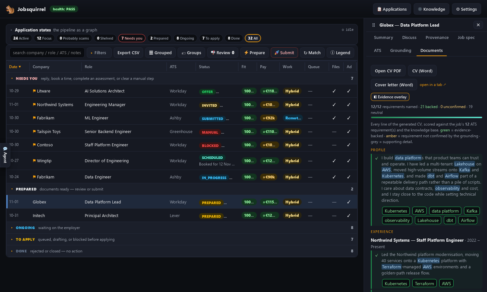

  

    <h1>Jobsquirrel</h1>
    
<strong>An open, self-hosted job-application agent: hand it your CV (resume) and it finds, tailors, gates and applies to jobs for you.</strong>

    
Honest, targeted and auditable: with a real knowledge graph, hard gates before anything is sent, and a scam detector that knows the difference between a recruiter and a wallet drain.

    

      
      
      
      
      
      
    

    

      <a class="primary" href="SETUP/">Quick start →</a>
      <a href="USING-IT/">How to use it</a>
      <a href="SCAMS/">The scam detector</a>
      <a href="https://github.com/bongomanuk/jobsquirrel">GitHub ↗</a>
    

  

  

## What it does

  

<svg viewBox="0 0 24 24" width="22" height="22" fill="none" stroke="currentColor" stroke-width="1.6" stroke-linecap="round" stroke-linejoin="round" aria-hidden="true"><circle cx="11" cy="11" r="6.5"/><path d="M20 20l-3.6-3.6"/></svg>
<h3>Discover</h3>
Reads LinkedIn job alerts and recruiter mail, dedupes against the register, and queues the roles worth doing.

  

<svg viewBox="0 0 24 24" width="22" height="22" fill="none" stroke="currentColor" stroke-width="1.6" stroke-linecap="round" stroke-linejoin="round" aria-hidden="true"><circle cx="12" cy="12" r="8"/><circle cx="12" cy="12" r="3"/><path d="M12 2v4M12 18v4M2 12h4M18 12h4"/></svg>
<h3>Target</h3>
A per-role CV and letter, grounded in your private knowledge graph, mirroring the advert without inventing anything.

  

<svg viewBox="0 0 24 24" width="22" height="22" fill="none" stroke="currentColor" stroke-width="1.6" stroke-linecap="round" stroke-linejoin="round" aria-hidden="true"><path d="M12 3l7 3v6c0 4-3 7-7 9-4-2-7-5-7-9V6z"/><path d="M9 12l2 2 4-4"/></svg>
<h3>Gate</h3>
Alignment, evidence, ATS coverage, identity and no-AI-slop gates. Nothing is uploaded until they pass.

  

<svg viewBox="0 0 24 24" width="22" height="22" fill="none" stroke="currentColor" stroke-width="1.6" stroke-linecap="round" stroke-linejoin="round" aria-hidden="true"><rect x="5" y="8" width="14" height="11" rx="2.5"/><path d="M12 8V5"/><circle cx="12" cy="4" r="1.4"/><path d="M9.5 13h.01M14.5 13h.01M9 16h6"/></svg>
<h3>Apply</h3>
Drives the employer's own ATS through a real Camoufox browser, then records the exact files and hashes.

  

<svg viewBox="0 0 24 24" width="22" height="22" fill="none" stroke="currentColor" stroke-width="1.6" stroke-linecap="round" stroke-linejoin="round" aria-hidden="true"><rect x="3" y="5" width="18" height="14" rx="2"/><path d="M3 7l9 6 9-6"/></svg>
<h3>Track</h3>
Reconciles Gmail, surfaces interviews and verification links, triages job mail the classifier missed, and keeps one source of truth for every role.

  

<svg viewBox="0 0 24 24" width="22" height="22" fill="none" stroke="currentColor" stroke-width="1.6" stroke-linecap="round" stroke-linejoin="round" aria-hidden="true"><circle cx="11" cy="11" r="6.5"/><path d="M20 20l-3.6-3.6M11 8v3"/></svg>
<h3>Warn</h3>
Flags recruitment scams before you engage: remote-access interviews, wallet drains, task scams, money mules and reshipping.

!!! tip "Everything is local"
    The dashboard, register, documents, browser and knowledge graph run on your
    machine. The only outbound calls are the ones you choose: the employer's site,
    Gmail/Calendar if enabled, and the model provider: **which can be a local
    model too**. Use opencode, Claude Code, Cursor or your own local AI agent.
    [Run it fully local →](AGENT-SETUP/#run-it-fully-local)

## A look at it

  
The grid: every role, its stage and its fit.

  
The role drawer: stage, gates, evidence, one-click action.

  
The knowledge universe: a central career hub, theme islands and weighted stars.

  
Settings → About: full health, version and this instance.

  
Evidence: every CV line scored against the ad and the graph.

## What the forest says

*Fictional voices from the forest. No animal was interviewed, employed, or asked to install AnyDesk.*

  

    
    <blockquote>“I used to scatter applications like acorns and hope one took root. Jobsquirrel made me slow down. It found the roles, pulled the right evidence out of my own notes, and wrote a CV I could defend. I went from thirty rushed applications to four I believed in, and one of them became the role I have now.”Rowan Ash: Red Squirrel</blockquote>
  

  

    
    <blockquote>“The gate is the part I did not know I needed. It caught a line in my CV that said I thrived under pressure, which is not true. I am a hedgehog. I roll into a ball. Jobsquirrel made me take it out, and the interview went better because everything I said was mine.”Hazel Thorn: Hedgehog</blockquote>
  

  

    
    <blockquote>“I work nights, so I used to read recruiter mail at 3am and talk myself into things. Jobsquirrel read the same mail, matched it to the right role, and put the interview on my calendar. It also refused a role that wanted me to install a screen-sharing tool before the call. I have talons. I do not need remote access.”Alden Birch: Tawny Owl</blockquote>
  

  

    
    <blockquote>“I am not a spreadsheet animal. Jobsquirrel kept every application, every document and every reply in one place, so I always knew which burrow I was in. When a rejection came, it closed the row and moved on. When an interview came, it was already on the calendar. I finished the season with a clean record and a job.”Bram Hollow: Badger</blockquote>
  

## Start here

- **[Introduction](INTRO.md)**: what it is, how it works end to end, the safety guarantees and the run modes.
- **[Setup](SETUP.md)**: install, dependencies, configuration, Gmail.
- **[Agent setup](AGENT-SETUP.md)**: opencode, Claude Code, Cursor, and **running it fully local**.
- **[Using it](USING-IT.md)**: the daily prompts, monitoring, the state model and the grid.
- **[The scam detector](SCAMS.md)**: the hard rule, every signal, the email checks and the limits.
- **[How Cascade is integrated](CASCADE.md)**: which surfaces are reactive islands, how the vanilla code talks to them, and what stays outside.
- **[All documentation](all.md)**: the full index.

---

**If it helps, give it a star**: it helps other people find it.

[GitHub](https://github.com/bongomanuk/jobsquirrel) · [Releases](https://github.com/bongomanuk/jobsquirrel/releases) · [Report an issue](https://github.com/bongomanuk/jobsquirrel/issues)

Made by [Peter Hollas](https://hollas.net) · [hollas.net](https://hollas.net)

Reactive UI by [Cascade](https://github.com/erobwen/liquefy), Robert Renbris · [Credits](CREDITS.md)

